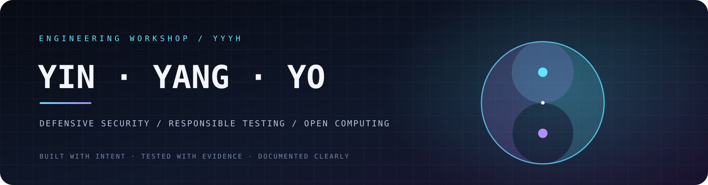
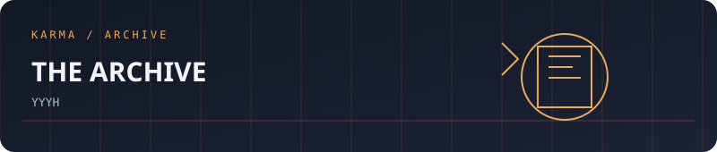
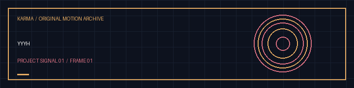

<!-- VISHWAS.EXE UNIFIED THEME START -->
<p align="center"><a href="https://yyyh-phi.vercel.app"></a></p>

<p align="center"><a href="https://vishwasaithalz.github.io/vishwasaithalz/">Personal index</a> &nbsp;·&nbsp; <a href="https://github.com/vishwasaithalz?tab=repositories">All projects</a> &nbsp;·&nbsp; <a href="https://vishwasaithal.ai.studio/">Portfolio</a></p>
<!-- VISHWAS.EXE UNIFIED THEME END -->

<details>
<summary>Earlier artwork and navigation</summary>

<p align="center"><a href="https://yyyh-phi.vercel.app"></a></p>
<p align="center"><strong>🌗 YinYangYoHackers</strong> · Cybersecurity learning and publishing</p>
<details>
<summary>Build and technology badges</summary>

<p align="center">
<a href="https://yyyh-phi.vercel.app"></a>
<a href="https://vishwasaithalz.github.io/vishwasaithalz/arcade/#chat"></a>
</p>

<details><summary>🎨 Open original full-size project artwork</summary>
<p align="center"></p>
</details>

</details>

<p align="center">
  <a href="https://github.com/vishwasaithalz/YYYH/actions/workflows/ci.yml"></a>
  
  
  
  
</p>
</details>

<p align="center"><strong>Independent security learning, practical engineering, and open computing.</strong></p>

<p align="center"><a href="https://yyyh-phi.vercel.app">Live project</a> · <a href="#the-idea">The idea</a> · <a href="#technology">Technology</a> · <a href="#run-locally">Run locally</a> · <a href="#security">Security</a></p>

<!--
  YinYangYoHackers
  A clean, maintainable home for the project's code, research and legacy archive.
-->

## The idea

YinYangYoHackers (YYYH) is a long-running independent technology project whose roots go back to **2013**. It brings together security learning, practical engineering, and the freedom to understand and improve the systems we use.

The project is organised around three complementary ideas:

| Pillar | Focus | What it means |
|---|---|---|
| **YIN** | Defensive security | Hardening, privacy, resilience, and safer defaults |
| **YANG** | Responsible security testing | Understanding weaknesses in systems you own or are authorised to assess |
| **YO** | Open computing | Useful tools, automation, experimentation, and accessible knowledge |

The goal is not noise or security theatre. It is practical work, documented clearly.

## What lives here

- **Web application**  -  the current TypeScript and React application.
- **Research and learning**  -  security and technology articles, notes, and explainers.
- **Legacy content archive**  -  a structured record of material from the project's earlier publishing history.
- **Engineering notes**  -  implementation logs, content inventory, and SEO planning.
- **Experiments**  -  small tools and integrations developed as the project evolves.

> This repository is a work in progress. A listed topic or planned capability should not be interpreted as a claim that a production-ready tool or formal security audit already exists.

## Technology

| Layer | Current project components |
|---|---|
| Application | React 19, TypeScript |
| Build tooling | Vite 6, esbuild |
| Server | Node.js, Express |
| Styling and UI | Tailwind CSS, Motion, Lucide |
| AI integration | Google GenAI SDK, used through server-side application code |
| Compression | Express compression and Vite build tooling |

Versions and scripts are defined in [package.json](./package.json). The project uses a Bun lockfile.

## Run locally

### Requirements

- Node.js (use a current supported LTS release where possible)
- Bun, to keep dependency installation aligned with the committed lockfile

### Setup

```bash
git clone https://github.com/vishwasaithalz/YYYH.git
cd YYYH
bun install
```

Create a local environment file from the example:

```bash
cp .env.example .env
```

On Windows PowerShell, use:

```powershell
Copy-Item .env.example .env
```

Fill in only the environment variables required for the features you intend to run. Never commit your real `.env` file or API keys.

### Development and checks

```bash
bun run dev
bun run lint
bun run build
bun run start
```

Check the scripts in [package.json](./package.json) before running them. The production start command expects a successful build first.

## Project map

```text
.
├── assets/                  # Project assets
├── public/                  # Static files served by the application
├── scripts/                 # Project scripts
├── src/                     # Frontend application
├── .env.example             # Environment variable template
├── CONTENT_MANIFEST.md      # Legacy content inventory
├── IMPLEMENTATION_LOG.md    # Engineering change notes
├── SEO_IMPLEMENTATION_PLAN.md
├── server.ts                # Server entry point
├── package.json             # Scripts and dependencies
└── vite.config.ts            # Vite configuration
```

## Working principles

1. **Authorisation first.** Test only systems you own or have explicit permission to assess.
2. **Privacy by default.** Keep credentials server-side, use environment variables, and collect only what a feature genuinely needs.
3. **Evidence over claims.** Document what was built, how it was tested, and what remains incomplete.
4. **Preserve useful history.** Improve and organise legacy material rather than erasing the project's roots.
5. **Keep it maintainable.** Prefer understandable code, reproducible setup, and focused changes.

## Roadmap

- [ ] Complete a repository and dependency hygiene review.
- [ ] Document application architecture and required environment variables.
- [ ] Verify the production build and deployment configuration.
- [ ] Review accessibility, mobile behaviour, performance, and error states.
- [ ] Continue organising and improving the legacy content archive.
- [ ] Publish clear documentation for each tool before calling it production-ready.

## Security

Please read [SECURITY.md](./SECURITY.md) before reporting a vulnerability. Do not include secrets, personal data, or exploit details in public issues.

## Contributing

Small, focused, well-explained contributions are welcome. Start with [CONTRIBUTING.md](./CONTRIBUTING.md), describe the problem, and include steps to reproduce and test your change.

---

<div align="center">

**YIN for resilience · YANG for understanding · YO for building**

*Independent project. Evolving in public, one verifiable improvement at a time.*

</div>


<!-- KARMA VISUAL IDENTITY: START -->
<div align="center">

**ARCHIVE / SECURITY / KNOWLEDGE**

 

<sub>Designed for clarity. Built for evidence. No invented status metrics.</sub>

</div>
<!-- KARMA VISUAL IDENTITY: END -->


<!-- KARMA ANIMATED SIGNAL -->
<p align="center"></p>
<details><summary><strong>🎛 Explore the interactive Vishwas Aithal universe</strong></summary><p><a href="https://karma-ops-monitor.vercel.app">Launch the music-enabled Vishwas Aithal homepage</a>. Sound is user-controlled. Motion can be reduced.</p></details>


<!-- KARMA AVATAR GALLERY -->
<p align="center"></p>
<p align="center"><a href="https://karma-ops-monitor.vercel.app/#gallery">Explore the animated project gallery</a></p>


### Original motion gallery



[Download this project's GIF](assets/karma-motion.gif) · [View the animated SVG](assets/karma-signal.svg)
